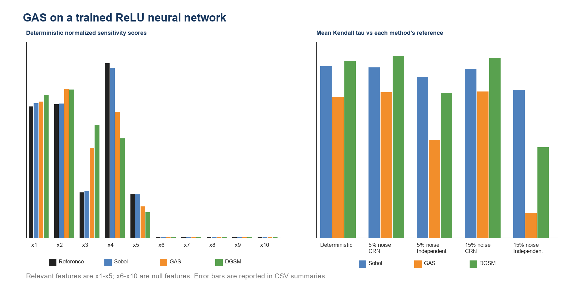
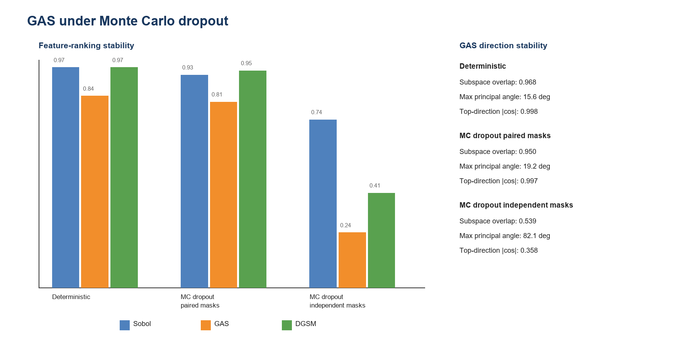
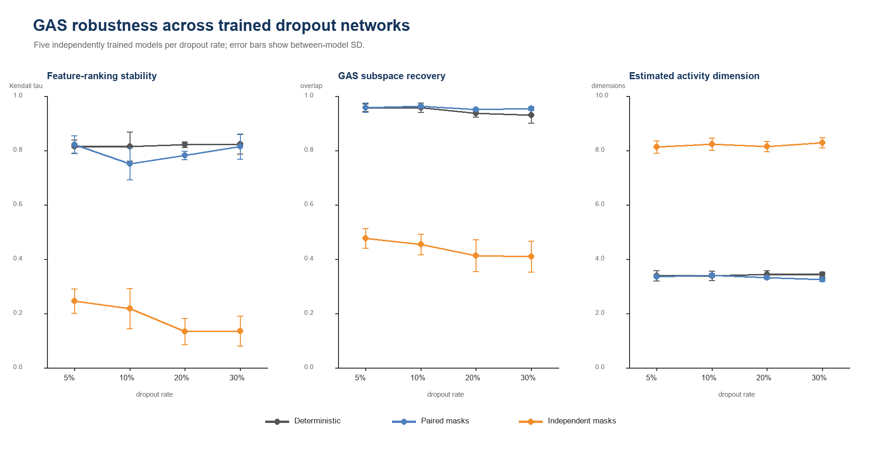
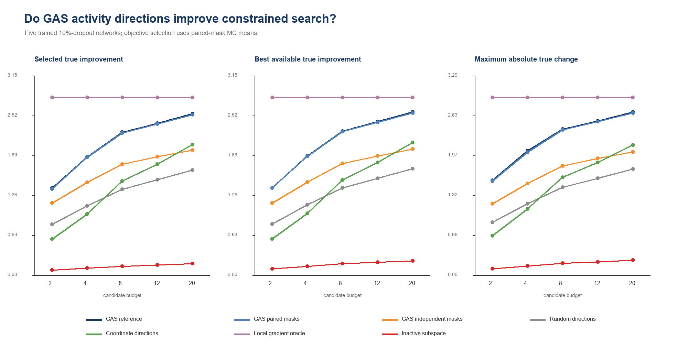
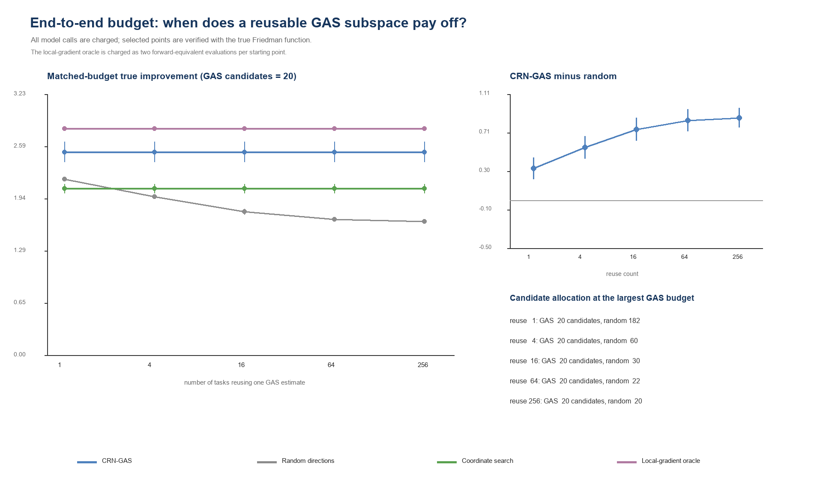
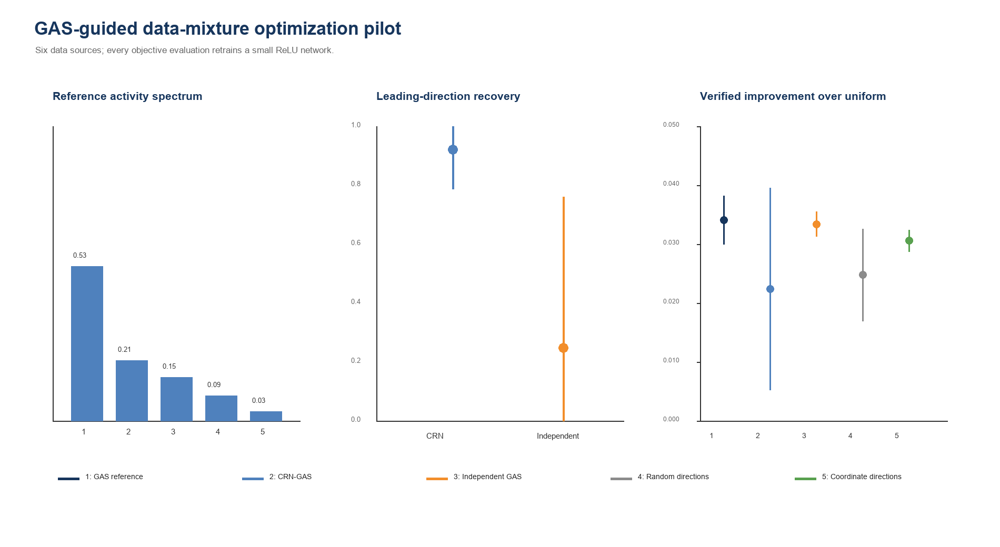
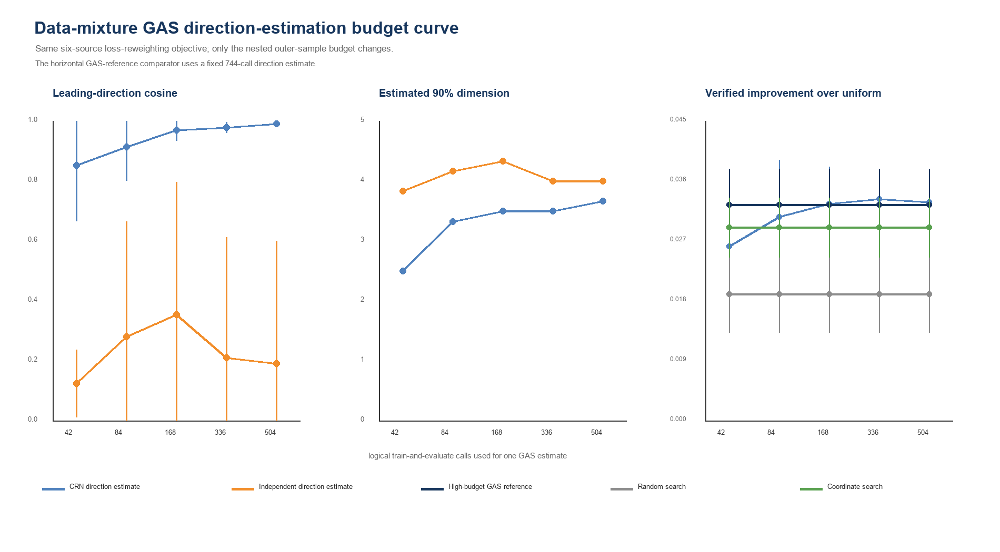

# GAS for Neural Networks

This module studies whether Global Activity Scores (GAS) can provide stable
global input-sensitivity rankings and low-dimensional activity directions for
deterministic and stochastic neural networks.

The current evidence supports a deliberately limited conclusion:

> GAS can recover influential inputs and stable activity subspaces from a
> trained ReLU network when paired evaluations share their random state.
> Independent stochastic evaluations can instead create false sensitivity and
> a spurious high-dimensional activity space.

The experiments do **not** show that GAS is universally more accurate than
Sobol total-effect indices or DGSM for feature ranking. The potential advantage
of GAS is its joint activity-subspace information.

## Repository layout

```text
gas_neural_network/
├── experiments/
│   ├── neural_network_gas_demo.py
│   ├── neural_network_gas_mc_dropout.py
│   ├── neural_network_gas_mc_dropout_sweep.py
│   ├── neural_network_gas_direction_intervention.py
│   ├── neural_network_gas_end_to_end_budget.py
│   ├── gas_data_mixture_pilot.py
│   └── gas_data_mixture_budget_curve.py
├── results/
│   ├── pilot/
│   ├── mc_dropout_pilot/
│   ├── dropout_sweep/
│   ├── direction_intervention/
│   ├── end_to_end_budget/
│   ├── data_mixture_pilot/
│   └── data_mixture_budget_curve/
├── figures/
├── reports/
├── README.md
└── requirements.txt
```

The committed result directories contain the compact tables needed to inspect
the conclusions. Per-repeat files from the 20-model sweep are intentionally not
committed.

## Benchmark problem

All experiments use the 10-dimensional Friedman benchmark

\[
Y=10\sin(\pi X_1X_2)+20(X_3-0.5)^2+10X_4+5X_5,
\]

with independent inputs \(X_i\sim U(0,1)\). Only `x1`--`x5` are relevant;
`x6`--`x10` are null features. A two-hidden-layer ReLU MLP is trained in NumPy
and then treated as a black-box model.

The three sensitivity estimators use approximately matched evaluation budgets:

- Sobol total-effect indices: 6,144 model evaluations;
- GAS with split Gauss--Legendre quadrature: 5,184 evaluations;
- DGSM with central finite differences: 5,120 evaluations.

Low-budget results are compared with a high-budget deterministic reference for
the **same method**. This avoids treating Sobol, GAS, and DGSM as identical
estimands.

## Experiment 1  Additive-noise pilot

`neural_network_gas_demo.py` trains a deterministic ReLU network and evaluates
the three methods under deterministic predictions and Gaussian output noise at
5% and 15% of the prediction standard deviation. Paired evaluations use either
common random numbers (CRN) or independent noise.

The network reaches a test \(R^2\) of approximately 0.992. All three methods
recover the five relevant features without noise. GAS retains 100% top-five
recovery under both CRN noise levels, but degrades severely under independent
noise.



## Experiment 2  Monte Carlo dropout pilot

`neural_network_gas_mc_dropout.py` replaces artificial output noise with
stochastic hidden-layer dropout. It compares:

1. deterministic inference with dropout disabled;
2. Monte Carlo dropout with paired masks for baseline and perturbed inputs;
3. Monte Carlo dropout with independent masks.

At 10% dropout, paired masks preserve 100% top-five recovery, a GAS subspace
overlap of 0.950, and a first-direction absolute cosine of 0.997. Independent
masks reduce subspace overlap to 0.539, increase the maximum principal angle to
82.1 degrees, and inflate the estimated 90%-energy dimension from about 3--4 to
about 8.



## Experiment 3  Multi-model dropout sweep

`neural_network_gas_mc_dropout_sweep.py` trains 20 independent models:

- five independent training seeds;
- dropout rates of 5%, 10%, 20%, and 30%;
- 12 sensitivity repetitions for each trained model and protocol.

The independently trained network is the statistical unit in the aggregate
tables. Student-t intervals are computed across the five trained models at each
dropout rate, avoiding pseudo-replication from the 12 internal sensitivity
repeats.

Across all dropout rates, paired masks give:

- 100% GAS top-five recovery;
- GAS subspace overlap between 0.952 and 0.964;
- an estimated activity dimension of approximately 3.3--3.4;
- first-direction absolute cosine above 0.996.

Independent masks give subspace overlap between 0.411 and 0.478 and inflate the
estimated activity dimension to approximately 8.2. The paired-versus-independent
contrast is consistent across independently trained models.



## Experiment 4  Direction intervention

`neural_network_gas_direction_intervention.py` tests whether the recovered GAS
subspace is useful for constrained black-box search. Five independently trained
10%-dropout networks are evaluated from 256 held-out starting points per model.
Every method receives the same candidate budgets of 2, 4, 8, 12, or 20 points
inside an L2 trust region of radius 0.15.

The compared search spaces are:

- the high-budget deterministic GAS reference subspace;
- a low-budget GAS subspace estimated with paired dropout masks;
- a low-budget GAS subspace estimated with independent masks;
- random full-dimensional directions;
- coordinate directions;
- the deterministic local-gradient direction as an oracle;
- the reference inactive subspace as a negative control.

Candidate selection uses a 32-pass paired-mask MC-dropout mean. The selected
candidate is then evaluated with the known Friedman function, so improvement is
not judged only by the fitted neural network.

At a 20-candidate budget, the mean verified objective decreases are:

- local-gradient oracle: 2.811;
- high-budget GAS reference: 2.555;
- low-budget paired-mask GAS: 2.536;
- coordinate search: 2.067;
- independent-mask GAS: 1.980;
- random directions: 1.663;
- inactive subspace: 0.185.

Paired-mask GAS exceeds random search by 0.873 on average, with a cross-model
95% Student-t interval of [0.784, 0.961]. It is nearly indistinguishable from
the high-budget GAS reference, although the local-gradient oracle remains 0.276
better on average. Direction-estimation cost is reported separately and is not
included in the candidate budget, so this experiment establishes conditional
direction quality rather than end-to-end compute efficiency.



## Experiment 5  End-to-end matched budget

`neural_network_gas_end_to_end_budget.py` charges all forward evaluations used
to estimate the CRN-GAS subspace and to select intervention candidates. The GAS
dimension is selected from the charged low-budget estimate itself; no
high-budget reference dimension is used. One CRN-GAS estimate costs 5,184
model evaluations and can be amortized across 1, 4, 16, 64, or 256 optimization
tasks.

At the largest GAS search budget, one-shot CRN-GAS uses 20 candidates after
paying for its subspace, while random and coordinate search can use 182
candidates at the same total budget of 5,856 evaluations per task. Even in this
conservative case, the mean verified improvement is 2.521 for CRN-GAS versus
2.189 for random search. The paired difference is 0.333 with a cross-model 95%
Student-t interval of [0.219, 0.446]. Coordinate search reaches 2.067 and the
white-box local-gradient oracle reaches 2.811.

The benefit depends on how much candidate search is performed. With only four
GAS candidates, the subspace must be reused about 16 times before its advantage
over random search has a strictly positive cross-model 95% interval. The first
conclusive reuse counts are 16, 4, 1, and 1 for GAS candidate budgets of 4, 8,
12, and 20, respectively. Thus GAS is most attractive when the global subspace
is reused, but a sufficiently thorough GAS-directed search can already repay
its estimation cost in a one-shot task on this benchmark.



## Experiment 6  Data-mixture pilot

`gas_data_mixture_pilot.py` moves the variables from ordinary input features to
six data-source weights on a simplex. The weights are represented by five
orthonormal centered log-ratio coordinates. Every black-box objective
evaluation retrains a one-hidden-layer ReLU MLP for 120 steps and returns clean
validation loss; paired evaluations either reuse or independently redraw the
training initialization and minibatch stream.

The first result is positive for estimation protocol but deliberately negative
for optimization advantage. At 168 train-and-evaluate calls per GAS estimate,
CRN recovers the leading high-budget activity direction with mean absolute
cosine 0.922, compared with 0.248 under independent training randomness. CRN
also reduces the estimated 90%-energy dimension from 4.2 to 3.0 on average.

However, the high-budget reference itself needs four of five directions to
explain 90% of activity (energy fractions 0.53, 0.21, 0.15, 0.09, and 0.03).
The mixture objective therefore has weak low-dimensional structure. With 20
candidate mixtures, all methods improve over the uniform mixture, but the mean
verified improvements are:

- high-budget GAS reference: 0.0341 validation-MSE units;
- low-budget CRN-GAS: 0.0224;
- independent-noise GAS: 0.0334;
- random directions: 0.0248;
- coordinate directions: 0.0306.

The paired CRN-GAS-minus-random difference is -0.0024 with a 95% Student-t
interval of [-0.0158, 0.0110], and CRN-GAS-minus-coordinate is -0.0082 with an
interval of [-0.0248, 0.0084]. Thus this pilot does not establish an
optimization advantage for low-budget GAS. It instead identifies the next
methodological requirement: test a direction-estimation budget curve and/or
replace raw source weights with semantic factors such as data quality, domain
balance, and task-cluster proportions.



## Experiment 7  Data-mixture direction-estimation budget curve

`gas_data_mixture_budget_curve.py` holds the six-source loss-reweighting
objective and 20-candidate search protocol fixed while increasing the nested CRN-GAS
outer-sample budget. The five direction-estimation costs are 42, 84, 168, 336,
and 504 logical train-and-evaluate calls, with six paired repeats at every
budget. Independent-randomness GAS is retained as a negative protocol control.

The mean leading-direction absolute cosine with a fixed 744-call CRN reference
rises from 0.853 at 42 calls to 0.992 at 504 calls. The trace-normalized
activity-matrix error falls from 0.446 to 0.272; the paired decrease is 0.174
with a 95% Student-t interval of [0.103, 0.245]. The naive independent-seed
finite-difference control fails to stabilize in this boundary-sensitive design:
its leading-direction cosine is only 0.193 at 504 calls, versus 0.992 for CRN.

Conditional on the same 20 candidate mixtures, CRN-GAS first has a positive
unadjusted paired interval over random search at 84 direction-estimation calls. At 168
calls it also exceeds coordinate search by 0.00357 validation-MSE units, with a
95% interval of [0.00015, 0.00700]. At 504 calls, the corresponding advantages
are 0.01369 [0.01096, 0.01642] over random search and 0.00378 [0.00288,
0.00468] over coordinate search. At 504 calls, no difference from the fixed
high-budget GAS reference is detected; this is not an equivalence result.

This result refines the initial pilot: the earlier null search result was based
on one low-budget direction estimate reused across every search repeat. In the
revised protocol, each search repeat receives its own direction estimate and
the earlier null does not persist. This is not a strict replication because
the candidate-generation and evaluation seeds also differ. The reference spectrum still
needs four of five directions for 90% activity, so the benefit is better
orientation and prioritization rather than a strong dimension reduction.
Direction-estimation cost remains separate from the candidate budget, and all
repeats are conditional on one generated dataset; an end-to-end, multi-dataset
confirmation is still required.

Every method uses the same five full-radius and five half-radius paired
directions. The GAS search uses its own estimated 90%-energy dimension at each
budget, so the search curve evaluates the complete adaptive procedure rather
than direction orientation alone. Also, the current trainer samples a fixed
number of observations from every source and reweights their losses; true
mixture-proportional source sampling is reserved for the next stage.



A concise academic interpretation is available in
[`reports/data_mixture_budget_curve_report.md`](reports/data_mixture_budget_curve_report.md).

## Run the experiments

From the `gas_neural_network` directory:

```bash
python -m pip install -r requirements.txt
python experiments/neural_network_gas_demo.py
python experiments/neural_network_gas_mc_dropout.py
python experiments/neural_network_gas_mc_dropout_sweep.py
python experiments/neural_network_gas_direction_intervention.py
python experiments/neural_network_gas_end_to_end_budget.py
python experiments/gas_data_mixture_pilot.py
python experiments/gas_data_mixture_budget_curve.py
```

Useful options include:

```bash
python experiments/neural_network_gas_mc_dropout.py \
  --dropout-rate 0.10 --training-seed 20260930 --repeats 12

python experiments/neural_network_gas_mc_dropout_sweep.py \
  --dropout-rates 0.05 0.10 0.20 0.30 \
  --seeds 2026101401 2026101402 2026101403 2026101404 2026101405
```

## Main result tables

The most useful committed tables are:

- `results/pilot/stability_summary.csv`;
- `results/mc_dropout_pilot/stability_summary.csv`;
- `results/mc_dropout_pilot/gas_subspace_summary.csv`;
- `results/dropout_sweep/method_across_models.csv`;
- `results/dropout_sweep/gas_subspace_across_models.csv`;
- `results/dropout_sweep/protocol_contrasts_across_models.csv`;
- `results/dropout_sweep/gas_subspace_contrasts_across_models.csv`;
- `results/direction_intervention/intervention_across_models.csv`;
- `results/direction_intervention/method_contrasts_across_models.csv`;
- `results/end_to_end_budget/end_to_end_across_models.csv`;
- `results/end_to_end_budget/end_to_end_contrasts_across_models.csv`;
- `results/end_to_end_budget/break_even_summary.csv`;
- `results/data_mixture_pilot/gas_protocol_contrasts.csv`;
- `results/data_mixture_pilot/mixture_search_summary.csv`;
- `results/data_mixture_pilot/mixture_search_contrasts.csv`;
- `results/data_mixture_budget_curve/direction_diagnostics_summary.csv`;
- `results/data_mixture_budget_curve/direction_budget_contrasts.csv`;
- `results/data_mixture_budget_curve/budget_search_summary.csv`;
- `results/data_mixture_budget_curve/budget_search_contrasts.csv`.

## Interpretation and limitation

Common random numbers do not remove stochasticity. They give the baseline and
its perturbation the same random environment, so their difference more directly
measures the input perturbation. With independent dropout masks, the finite
difference also contains the change in the network's active internal pathways.

The feature-level studies establish feasibility, stochastic-protocol
robustness, conditional direction usefulness, and end-to-end budget value on
one synthetic regression family. The data-mixture studies show that the CRN
principle transfers to a stochastic retraining objective and that adequately
estimated GAS directions can improve fixed-budget candidate search even when
the activity spectrum is nearly full-dimensional. They do not yet establish
an end-to-end data-mixture advantage across independently generated datasets.
Before moving to language-model tuning, the next experiment should freeze a
budget on development seeds, confirm it on held-out data-generation seeds, and
test whether raw source-weight directions align with predeclared semantic
contrasts rather than defining an artificially low-dimensional search space.
